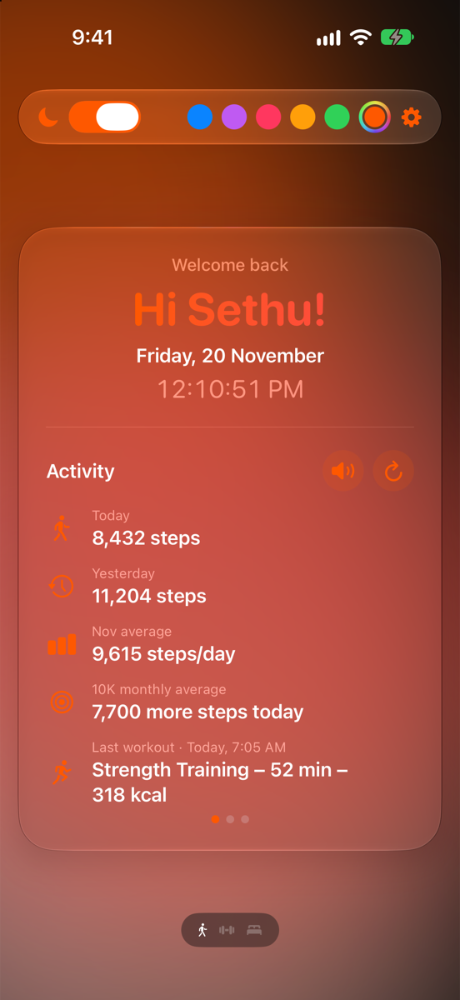
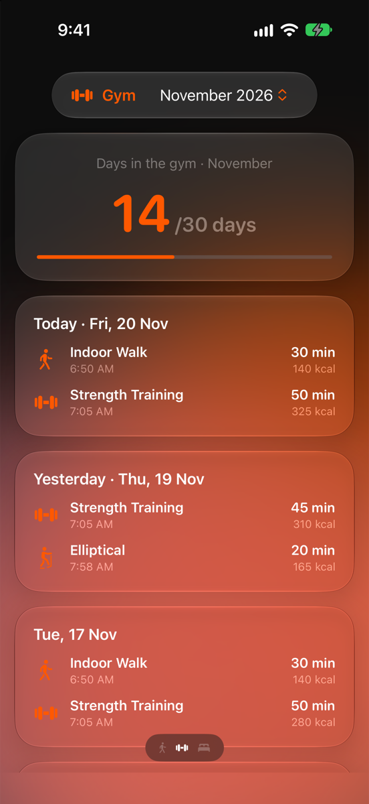
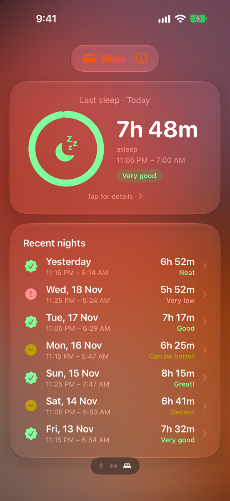
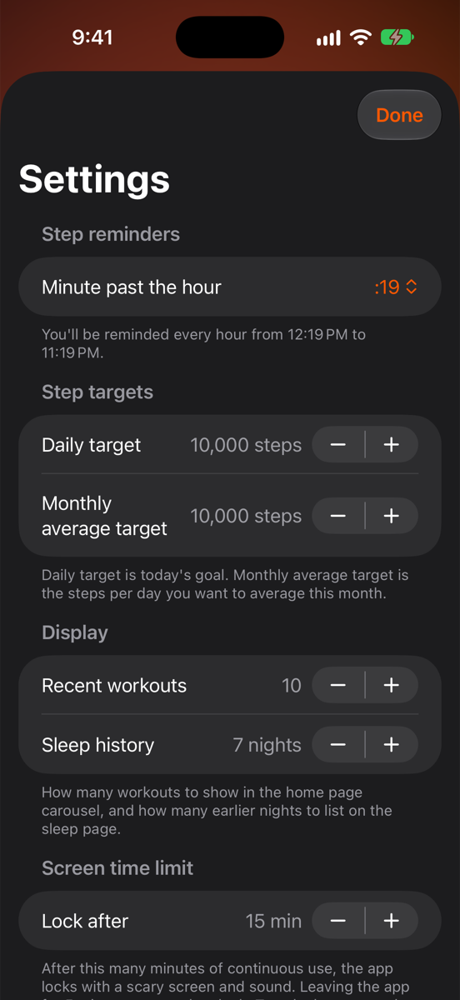

# Vetri Nadai

**Vetri Nadai** (Tamil for "victory walk") is a SwiftUI app for iPhone, iPad, Mac and Apple Vision Pro. It uses Apple Health data to track your steps, workouts and sleep. It sends hourly reminders to keep you walking, celebrates goals with fireworks, and has a screen-time lock so the app itself isn't overused.

## Screenshots

| Home | Gym | Sleep | Settings |
|---|---|---|---|
|  |  |  |  |

Screenshots use sample data. See [Taking screenshots](#taking-screenshots).

## Features

### Home page: step tracking
- **Personal greeting:** on first launch the app asks for your name (on Mac it fills this in automatically). It then shows "Hi *name*!" with today's date and a live 12-hour clock.
- **Activity stats from Apple Health:**
  - Steps today
  - Steps yesterday
  - The month's average steps per day so far
  - How many more steps you need today to keep your monthly average on target, or **"Reached!"** in green once you're on track
- **Recent workouts carousel:** swipe through your latest workouts (1–20, set in Settings). Each one shows:
  - the type (Outdoor Walk, Indoor Run, Cycle, Swimming, Yoga, HIIT, Strength Training, Dance, and more)
  - when it happened ("Today", "Yesterday" or a date)
  - duration, distance, steps during the workout, and active calories
- **Refreshing:** the stats update automatically every 60 seconds while the app is open. There's also a manual refresh button.
- **Background updates:** Apple Health wakes the app up to once an hour when new steps are recorded, so reminders stay accurate.

### Fireworks
- Tap anywhere on the screen to launch a firework at that spot.
- Tap your name to launch a show of 5 rockets.
- When you've reached your monthly-average target, a firework show plays automatically when you open the app.
- Once the target is reached, fireworks come with **sound** (booms and crackles generated in code, no audio files). A mute button turns the sound off.

### Gym page
Swipe to the second page, or use the tab on Mac.

- **Gym days counter:** shows how many days you went to the gym out of the days in the month (for example **14/31 days**), with a progress bar.
- **Month picker:** choose the current month or any of the previous 11.
- **Workouts grouped by date:** each gym day lists its workouts with start time, duration and active calories. The newest day is at the top.
- **What counts as a gym day:** any day with an Indoor Walk, Strength Training (functional or traditional) or Elliptical workout from Apple Health.

### Sleep page
Swipe to the third page, or use the tab on Mac.

- **Last sleep card:**
  - total time asleep, bedtime and wake time
  - a ring that fills toward an 8-hour goal
  - a colour-coded rating
- **Sleep ratings** (only actual sleep counts, not time awake in bed):

  | Rating | Time asleep |
  |---|---|
  | 🔴 Very low | Under 6h |
  | 🟡 Can be better | 6h – 6h 30m |
  | 🟡 Decent | 6h 30m – 6h 45m |
  | 🟢 Neat | 6h 45m – 7h |
  | 🟢 Good | 7h – 7h 30m |
  | 🟢 Very good | 7h 30m – 8h |
  | 🟢 Great! | 8h or more |

- **Recent nights list:** shows 1–14 earlier nights (set in Settings). Each has its duration and rating.
- **Night details** (tap any night):
  - a timeline chart of the sleep stages through the night
  - Deep, REM and Core sleep, each with its duration and percentage
  - how many times you woke up and for how long
- **Data handling:**
  - Anything recorded after 6 PM counts toward the next morning's night.
  - If an Apple Watch recorded sleep stages, those are used instead of rougher data from other sources.
  - Awake periods shorter than a minute are ignored.
- An ⓘ button explains how the ratings work.

### Hourly step reminders
- Notifications every hour from **12 PM to 11 PM**, at a minute you choose (default :19).
- Messages are personal and use the latest numbers. For example: *"Hey Sethu, you need 3,200 more steps today to hit your 10,000 target, and 8,500 more steps to get your monthly average on track. Come on, you've got this! 💪"*
- Reminders stop once both the daily and monthly targets are met.
- Tomorrow's reminders are also scheduled as a fallback, in case the app doesn't refresh before then.
- Notifications show even while the app is open.

### Screen-time lock (parental control)
- After a set time of continuous use (default **15 minutes**, adjustable 0–120, 0 turns it off), the app locks itself.
- The lock shows a **scary full-screen image** and plays a looping devil growl and evil laugh, generated in code.
- Leaving the app for **5 minutes** counts as a break and restarts the timer.
- The lock stays on even if the app is closed and reopened.
- **Hidden unlock for parents:** press and hold the scary screen for 5 seconds.

### Personalisation
- **Dark mode** toggle.
- **Accent colour:** 5 preset colours (blue, purple, pink, orange, green) plus a custom colour picker. The colour is used throughout the app.
- **Animated background** of slowly moving blurred colour blobs based on your accent colour.
- A frosted-glass look on the cards and controls.

### Settings

| Section | Options |
|---|---|
| Step reminders | Minute past the hour (:00–:59) |
| Step targets | Daily target and monthly average target (1,000–50,000, in steps of 500; default 10,000) |
| Display | Number of recent workouts (1–20) and sleep history nights (1–14) |
| Screen time limit | Lock after 0 (off) to 120 minutes |

## Technical details
- **Built with:** SwiftUI, HealthKit, Swift Charts, UserNotifications and AVFoundation (sound is generated in code).
- **Platforms:** iOS, iPadOS, macOS and visionOS.
- **Health data read:** steps, walking/running, cycling and swimming distance, active energy, workouts, and sleep. The app only reads data; it never writes to Health.
- **Storage:** all settings are stored on the device.

## Project structure

| File | Purpose |
|---|---|
| `MyApp.swift` | App entry point; starts reminders and background step updates |
| `ContentView.swift` | Home page, fireworks, animated background, theme controls |
| `StepCounter.swift` | Reads steps and workouts from HealthKit |
| `GymTracker.swift` | Finds gym workouts in HealthKit and groups them by day |
| `GymView.swift` | Gym page with month picker and gym-day count |
| `StepReminders.swift` | Schedules hourly step reminder notifications |
| `SleepTracker.swift` | Reads sleep data and groups it into nights |
| `SleepView.swift` | Sleep page, night details and rating guide |
| `SettingsView.swift` | Settings screen |
| `UsageLimit.swift` | Screen-time lock and its sound |
| `CelebrationSound.swift` | Firework sound effects |
| `DemoData.swift` | Sample data for screenshots (Debug builds only) |

## Getting started
1. Open `Vetri Nadai.xcodeproj` in Xcode.
2. Select your own development team under **Signing & Capabilities**. HealthKit needs a signed build.
3. Run it on a real iPhone, ideally with an Apple Watch paired, to see step, workout and sleep data.
4. When the app asks, allow access to Health and notifications.

## Taking screenshots
Debug builds include a sample-data mode, so you can take screenshots without real Health data. Launch the app with these arguments (in Xcode, **Product ▸ Scheme ▸ Edit Scheme ▸ Run ▸ Arguments**):

| Argument | Effect |
|---|---|
| `-demoData` | Uses sample steps, workouts, gym days and sleep instead of Health data |
| `-userName Sethu` | Sets the greeting name |
| `-demoPage 1` | Opens on a page: `0` Home, `1` Gym, `2` Sleep |
| `-demoSettings YES` | Opens the Settings sheet |

Sample-data mode is not included in Release builds.
